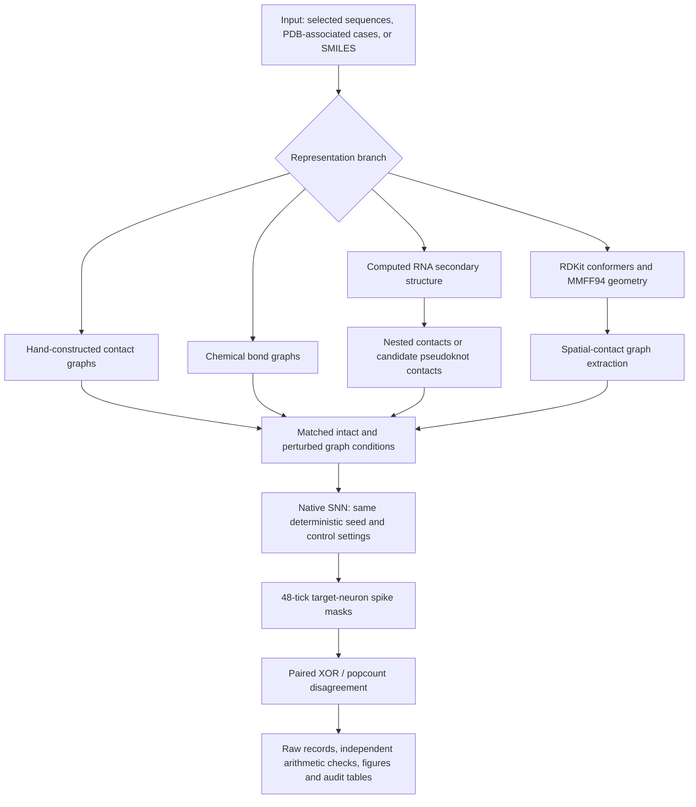
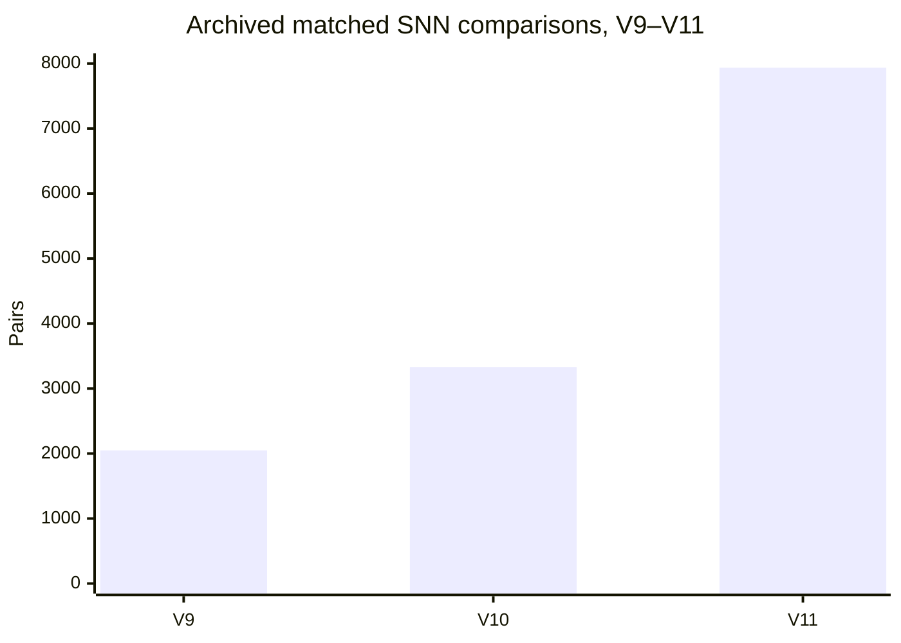

Structural Sensitivity in a Native Spiking Neural Network Under Molecular Graph Interventions
N-Molecular Research · V3–V11
Controlled graph perturbations, native neural spike dynamics, RNA pairing models, molecular mechanics, and independently auditable computational evidence
- Repository: fireside25a-beep/N-Molecular-Research
- Status: Archived computational research, with source, experimental outputs, negative controls, audit tables, and historical releases. Not a validated biological structure-prediction system.
Research question. Can a native spiking neural network (SNN) produce measurable, reproducible changes in its activity when the connectivity of a molecularly derived graph is altered under matched computational conditions?
What the evidence supports. The archived experiments demonstrate computational sensitivity to selected graph interventions and deterministic reproduction of the recorded neural-response measurements. They do not establish experimentally accurate DNA/RNA folding, drug binding, or an advantage over validated structure-prediction tools.

At a glance
Archived measurement	Documented result	Interpretation
V9–V11 paired neural comparisons	13,312	Intact-versus-perturbed computational network responses, not biological samples
V9 / V10 / V11 paired comparisons	2,048 / 3,328 / 7,936	Different experimental branches; do not treat as one accuracy benchmark
V11 native SNN executions	15,872	Two separately reset executions per comparison
Native network scaffold	118 neurons; 324 directed synapses	Original native network before experiment-specific graph contacts
Archived classification / factorial audit	100 classifier-statistic rows; 208 condition summaries	Separate evidence streams, not predictive-accuracy scores
V11 stimulation schedule	64 deterministic seeds; 48 ticks per execution	Reproducible, computational experimental controls
V11 force-field minimizations	13/13 converged	Numerical MMFF94 calculations, not experimental structure validation
V11 sampled gradient-check maximum error	1.59 × 10⁻⁷ kcal/mol/Å	Agreement of finite-difference and analytical calculations on sampled components
V11 named project Python tests	81 passing in archived logs	Historical test evidence; not a new test run on a reader's machine
V11 compiler parity	7,936 matched GCC/Clang comparison records	Archived byte-identical output records
Git publication snapshot	405 preserved source-tree file paths; 6 ZIP paths	Verified against the local source SHA-256 manifest before Git staging

Read the science first: [Research article (PDF)](original_extracted/Molecular_Graph_Research_Publication_20261023/01_Research_Article/Research_Article.pdf) · [Study explanation](original_extracted/Molecular_Graph_Research_Publication_20261023/03_Study_Guide/ABOUT_THE_STUDY.md) · [Methods and equations](original_extracted/Molecular_Graph_Research_Publication_20261023/03_Study_Guide/METHODS_AND_EQUATIONS.md) · [Claim–evidence matrix](original_extracted/Molecular_Graph_Research_Publication_20261023/04_Data_And_Results/CLAIM_EVIDENCE_MATRIX.csv)
1. What N-Molecular actually does
This project investigates the relationship between graph representation and neural response. It translates selected molecular inputs or computed structural representations into graphs, applies controlled changes to graph connections, and runs a native executable spiking-neural system under matched stimulation. It then compares the resulting spike-event masks.
The preserved native computational scaffold contains 118 neurons and 324 directed synapses, with experiment-specific input nodes and contact edges introduced for the declared trials. Each paired comparison resets the native network and holds the deterministic seed and stimulation policy matched, varying the recorded computational contact connections. The original native state-transition routine is retained; this is not merely an offline graph-score calculation.
The research spans several distinct levels of representation:
- Hand-specified DNA/RNA contact graphs: controlled graph-label and rewiring experiments, including cycle-preserving negative controls.
- Chemical-bond graphs: small molecules represented from SMILES inputs, followed by selected bond-removal interventions.
- RNA secondary-structure graphs: predicted base-pair contacts from a weighted noncrossing Nussinov solver (V10) and a partial nearest-neighbor thermodynamic model (V11).
- Candidate pseudoknot graphs: a heuristic crossing-stem branch, not a validated pseudoknot predictor.
- Geometry-derived graphs: RDKit ETKDG conformers and MMFF94 calculations used to construct selected spatial-contact graphs; for the RNA atomistic branch the calculations involve four-nucleotide fragments, not whole RNA molecules.
The key experimental output is neural-response disagreement between paired graph conditions. It is not a prediction of binding affinity, measured fold correctness, or disease activity.
Research workflow

The graph is a map of the documented experimental design; its branches are not a claim that every version uses every algorithm. The original results distinguish graph-label classification from spike-mask disagreement rather than merging these endpoints into an undefined notion of "molecular understanding."
What is compared?
For each matched pair, the recorded analysis uses 48 time steps and 22 selected target-neuron positions:
\[
D(\%) = 100\,\frac{\sum_{t=0}^{47}\operatorname{popcount}(S_{\mathrm{intact}}(t)\;\mathrm{XOR}\;S_{\mathrm{perturbed}}(t))}{48\times22}
\]
Across many pairs the numerator and denominator are summed over the records being aggregated. A disagreement value of 20% means different computational spike-mask bits, not 20% predictive accuracy. The V9–V11 experiments also cross closed-loop native-output-conditioned feedback versus a fixed-current schedule with STDP learning enabled versus frozen synaptic weights. The four arms are computational controls, not biological treatments.
2. Research progression: V3 through V11
Version	Question / implementation	Evidence and essential qualification
V3–V5	Early bridge from molecular structural inputs to native SNN experiments; initial six-case series	Historical sources and artifacts are preserved. These versions were not freshly rebuilt as part of the publication portfolio.
V6	Fresh-seed graph-label discrimination; cycle and motif-preserving controls	In one 1KF1 case, a cycle-breaking contrast yielded 196/256 (76.56%), while preserving the relevant rings yielded 116/256 (45.31%). This challenges a generalized geometry interpretation.
V7–V8	Additional RNA graph labels and falsification/statistical analysis	Four additional cases did not survive the documented Holm multiple-comparison correction. Negative findings are retained.
V9	Eight SMILES-based molecular graphs, chemical-bond ablations, four neural-control arms	2,048 paired comparisons; sensitivity is not binding or chemical-property prediction.
V10	Weighted noncrossing Nussinov RNA pairing; RDKit-derived small-molecule conformer graphs	3,328 paired comparisons; these are computational pair structures, not measured base-pair truth.
V11	Selected nearest-neighbor RNA terms, candidate pseudoknot search, MMFF94 force/gradient checks, post-optimization contact graphs	7,936 paired comparisons and 15,872 native executions; model is partial, RNA atomistic examples cover four-nucleotide fragments, and the main finding is SNN graph sensitivity.

The earlier V6–V8 classifier rows and the V9–V11 paired-execution counts measure different tasks. They should not be combined into a single molecular accuracy score or treated as independent biological samples.
Computational workload (paired comparisons)

These values describe execution volume, not progress in predictive accuracy.
3. Representative recorded findings
3.1 A negative control changes the interpretation
The V6 1KF1 example separates a cycle-breaking graph change from a ring-preserving graph change. The cycle-breaking comparison gave 196/256 (76.56%) correct graph labels, with a reported six-case Holm-adjusted p ≈ 0.0278. A distinct cycle-preserving rewire gave 116/256 (45.31%), without reliable discrimination. This contrast is consistent with the decoder responding to coarse graph-cycle structure. It does not demonstrate recognition of real DNA/RNA spatial geometry. The later V7–V8 multiplicity-corrected null results further limit the generality of the classifier findings.
 
Archived figure: held-out graph-label classification on computationally constructed contacts.
 
Archived figure: graph-cycle intervention control.
3.2 RNA pairing is an internal model, not a biological accuracy score
V10 used a weighted noncrossing pairing algorithm. V11 used selected Turner-derived nearest-neighbor terms and simplified loop contributions, plus a heuristic candidate pseudoknot branch. Across the five RNA cases reported for V11, the model produced 40 predicted nested base pairs. The archive explicitly does not supply a blind, experimental-base-pair precision/recall/F1 benchmark for this implementation.
V11 RNA case	Computed nested pairs	Partial-model energy (kcal/mol)	Candidate pseudoknot selected?
1ZIH	4	−2.74000	No
1ZIF	4	−2.74000	No
1ZIG	4	−2.74000	No
2KOC	5	−5.43000	No
1EHZ	23	−14.60356	Yes, heuristic candidate

The numeric energies are outputs of the implemented partial model, not experimentally measured free energies and not the complete ViennaRNA/RNAfold thermodynamic treatment.
 
Archived figure: different RNA pairing algorithms produce different calculated structures; neither bar constitutes an accuracy benchmark.
3.3 Spatial contacts and force calculations
The V11 reports record 13 converged MMFF94 minimizations, sampled analytical/finite-difference gradient agreement with a maximum absolute discrepancy of approximately 1.59 × 10⁻⁷ kcal/mol/Å, and 1,909 derived non-bonded spatial contacts supplied to graph-based interventions. These checks support internal numerical consistency and contact-graph construction. They do not validate the coordinates of a complete RNA or establish a novel force field.
 
Archived figure: sampled numerical-versus-analytical force-gradient comparisons.
3.4 Cross-compiler and replay evidence
The preserved V11 reports document 7,936 GCC/Clang byte-identical comparison records, 248 separately sampled ASan/UBSan matched records, 81 passing named project Python tests, and byte-for-byte replay of the earlier V10 set of 3,328 comparison records using a rebuilt V11 executable.
Important test-status distinction: an attempted one-shot V11 upstream make test run was interrupted. It is not described here as a completed passing full-suite run. Earlier V10 upstream full-suite evidence and separate V11 command-level checks are preserved in the logs.
4. Evidence and test matrix
The following table distinguishes recorded experiment results, historical software-test receipts, independent numerical audits, and current local release integrity checks. A pass in one category must not be presented as proof of a different category.
Verification layer	Documented outcome	Meaning and boundary
Graph-label generalization	Six held-out V6 cases; 128 fresh seed pairs per case, 256 labels per case	Graph-intervention identification on constructed inputs, not held-out molecular-fold prediction
Strong graph-cycle contrast	1KF1 cycle-breaking: 196/256, 76.56%; Holm-adjusted p ≈ 0.0278	Statistical result is conditional on the constructed graph labels and permutation design
Cycle-preserving falsification	Separate 1KF1 rewire: 116/256, 45.31%	No demonstrated graph-label separation for this control
Additional RNA-labelled negatives	Four V7–V8 cases did not survive Holm correction	Negative evidence retained rather than selectively omitted
Classifier null/statistical audit	4,096 label-sign-swap permutations in the V6 setup; 100 archived classification-statistic rows	Conditional computational null and multiplicity correction, not population biological inference
Paired neural readout	13,312 V9–V11 paired masks independently recomputed; no count mismatches in the archived audit	Integer XOR/popcount verification across recorded 48-tick, 22-slot masks
Factorial summary audit	208 archived four-arm condition summaries	Summary reconstruction from recorded paired outcomes
V11 experiment partition	1,280 nested RNA + 1,280 candidate-pseudoknot + 2,048 ligand + 3,328 post-force = 7,936 pairs	Distinct representation/intervention branches; not 7,936 biological specimens
Deterministic V11 workload	64 excitation seeds × 48 ticks; 15,872 native resets/executions	Source-reported execution workload on an archived host
Cross-compiler parity	7,936 GCC/Clang paired comparison records byte-identical	Same recorded outputs across two compiler builds in the archived tests
Sanitizer sample	248 ASan/UBSan comparison records matched	Sampled sanitizer run, not a full 7,936-record sanitizer pass
Prior-version replay	3,328 V10 records reproduced byte-for-byte using rebuilt V11 native executable	Historical deterministic replay evidence
Python project regression	81 named V11 Python tests passed in preserved logs	Test outcomes are historical; not newly rerun during README preparation
Upstream suite	V10 full upstream run passed; V11 one-shot make test was interrupted, with separate subsequent checks	Do not label the V11 one-shot full suite as PASS
Atomistic numerical consistency	13/13 MMFF94 minimizations converged; sampled maximum gradient difference ≈ 1.59 × 10⁻⁷ kcal/mol/Å	Internal numerical consistency; no external force-field validation
Publication archive preservation	405/405 original file SHA-256 matches, 65 original directories, 6/6 nested ZIP CRC passes	Local Git staging and archive integrity, not fresh scientific re-execution

For the exact experiment records and qualifications, see the [full manuscript](original_extracted/Molecular_Graph_Research_Publication_20261023/01_Research_Article/Research_Article.pdf), [claim-evidence matrix](original_extracted/Molecular_Graph_Research_Publication_20261023/04_Data_And_Results/CLAIM_EVIDENCE_MATRIX.csv), [technical supplement](original_extracted/Molecular_Graph_Research_Publication_20261023/05_Technical_Supplement/TECHNICAL_VALIDATION.md), and [preserved experimental logs](original_extracted/Molecular_Graph_Research_Publication_20261023/06_Experimental_Evidence/original_logs/).
 
Software regression coverage shown in the publication is separate from experimental structure-prediction accuracy.
5. Repository map
The GitHub repository preserves the original research publication tree under original_extracted/; it does not flatten historical archives into unrelated new files.
N-Molecular-Research/
├── README.md                             ← repository guide (this document)
├── .gitattributes                        ← ZIP objects tracked using Git LFS
├── EVIDENCE/
│   ├── SOURCE_SHA256_MANIFEST.csv        ← all 405 original relative paths, sizes, hashes
│   ├── SOURCE_DIRECTORIES.txt            ← original directory inventory
│   ├── LARGE_FILE_INVENTORY.json
│   ├── COPY_VERIFICATION.json            ← source-to-stage copy receipts
│   └── EMPTY_DIRECTORIES.txt
└── original_extracted/
    └── Molecular_Graph_Research_Publication_20261023/
        ├── START_HERE.md
        ├── FOLDER_GUIDE.md
        ├── 01_Research_Article/            ← Research_Article.pdf + .tex
        ├── 02_Publication_Figures/         ← 14 named PNG publication figures
        ├── 03_Study_Guide/                ← explanation, equations, study guide PDF
        ├── 04_Data_And_Results/           ← raw-derived CSVs, workbook, claim matrix
        ├── 05_Technical_Supplement/       ← technical validation narrative
        ├── 06_Experimental_Evidence/      ← original logs + evidence ZIP (LFS)
        ├── 07_Reproduce_And_Verify/       ← original validators and manuscript tools
        ├── 08_Executable_Source_Archive/  ← native source/binary ZIP (LFS)
        ├── 09_Legacy_Edition/             ← prior editions, archives, figures
        ├── 10_Provenance_And_Integrity/   ← integrity records, logs, provenance
        └── 11_Editorial_Submission/       ← unsubmitted editorial drafts/checklists
The source-tree count of 405 files and 65 directories includes two macOS .DS_Store files. The Git repository additionally contains publication-control files in EVIDENCE/. These totals are file-path inventories, not counts of unique executable modules.
Navigate by purpose
If you want to…	Start here
Read the full academic-style manuscript	[Research_Article.pdf](original_extracted/Molecular_Graph_Research_Publication_20261023/01_Research_Article/Research_Article.pdf) or [LaTeX source](original_extracted/Molecular_Graph_Research_Publication_20261023/01_Research_Article/Research_Article.tex)
Understand the methodology without running code	[ABOUT_THE_STUDY.md](original_extracted/Molecular_Graph_Research_Publication_20261023/03_Study_Guide/ABOUT_THE_STUDY.md), [METHODS_AND_EQUATIONS.md](original_extracted/Molecular_Graph_Research_Publication_20261023/03_Study_Guide/METHODS_AND_EQUATIONS.md)
Inspect the evidence for specific claims	[CLAIM_EVIDENCE_MATRIX.csv](original_extracted/Molecular_Graph_Research_Publication_20261023/04_Data_And_Results/CLAIM_EVIDENCE_MATRIX.csv), [DATA_DICTIONARY.md](original_extracted/Molecular_Graph_Research_Publication_20261023/04_Data_And_Results/DATA_DICTIONARY.md)
Recompute summaries or inspect comparison denominators	[ALL_V9_V10_V11_PAIRED_COMPARISONS.csv](original_extracted/Molecular_Graph_Research_Publication_20261023/04_Data_And_Results/ALL_V9_V10_V11_PAIRED_COMPARISONS.csv), [Research_Audit_Workbook.xlsx](original_extracted/Molecular_Graph_Research_Publication_20261023/04_Data_And_Results/Research_Audit_Workbook.xlsx)
Trace a figure to the source data	[FIGURE_PROVENANCE.csv](original_extracted/Molecular_Graph_Research_Publication_20261023/04_Data_And_Results/FIGURE_PROVENANCE.csv), [Publication figures](original_extracted/Molecular_Graph_Research_Publication_20261023/02_Publication_Figures/)
Inspect force-field records	[ATOMIC_FORCE_RESULTS.csv](original_extracted/Molecular_Graph_Research_Publication_20261023/04_Data_And_Results/ATOMIC_FORCE_RESULTS.csv)
Review historical neural, compiler, and sanitizer logs	[06_Experimental_Evidence/original_logs](original_extracted/Molecular_Graph_Research_Publication_20261023/06_Experimental_Evidence/original_logs/)
Inspect and independently verify preserved data	[07_Reproduce_And_Verify](original_extracted/Molecular_Graph_Research_Publication_20261023/07_Reproduce_And_Verify/)
Find the separately packaged native C/C++ project	[08_Executable_Source_Archive](original_extracted/Molecular_Graph_Research_Publication_20261023/08_Executable_Source_Archive/)
Audit archive provenance and historical changes	[10_Provenance_And_Integrity](original_extracted/Molecular_Graph_Research_Publication_20261023/10_Provenance_And_Integrity/) and [09_Legacy_Edition](original_extracted/Molecular_Graph_Research_Publication_20261023/09_Legacy_Edition/)

6. Reproducibility and integrity
Clone the complete publication with Git LFS
The six ZIP paths are stored through Git Large File Storage (LFS). Install Git and Git LFS first, then:
git clone https://github.com/fireside25a-beep/N-Molecular-Research.git
cd N-Molecular-Research
git lfs pull
git lfs ls-files
An ordinary GitHub-generated source ZIP may not include LFS file payloads, depending on GitHub's archive configuration. For complete archival material, a Git LFS-enabled clone is preferred.
Verify the original 405 file contents against the manifest
This read-only verification computes fresh SHA-256 digests for every original path after cloning. It needs Python 3 and does not execute any molecular model or change files:
python3 - <<'PY'
from pathlib import Path
from hashlib import sha256
import csv
import sys

root = Path('original_extracted')
manifest = Path('EVIDENCE/SOURCE_SHA256_MANIFEST.csv')
with manifest.open(encoding='utf-8', newline='') as f:
    rows = list(csv.DictReader(f))
if len(rows) != 405:
    sys.exit('FAIL: unexpected manifest length')
paths = [row['relative_path'] for row in rows]
if len(set(paths)) != 405:
    sys.exit('FAIL: repeated manifest path')
actual = {p.relative_to(root).as_posix() for p in root.rglob('*') if p.is_file()}
if set(paths) != actual:
    sys.exit('FAIL: file-path inventory differs from manifest')
for row in rows:
    p = root / row['relative_path']
    h = sha256()
    with p.open('rb') as stream:
        for block in iter(lambda: stream.read(1024 * 1024), b''):
            h.update(block)
    if p.stat().st_size != int(row['size_bytes']) or h.hexdigest() != row['sha256']:
        sys.exit('FAIL: integrity mismatch: ' + row['relative_path'])
print('PASS: 405/405 files match the preserved SHA-256 manifest')
PY
Note: The manifest includes original source-file paths only, not the newly written root README or the repository's control documents. The archive preservation gate compared all 405 originals with the staged copies and the Git index before publication. ZIP integrity was separately checked using per-member CRC tests; SHA-256 protects the entire archive's bytes.
Independent scientific checks versus full computational replay
There are three different levels of reproducibility. They should not be conflated:
1. Publication integrity: reproduce manifest hashes, figures, tables, and the archive inventory without running the SNN.
2. Evidence re-verification: inspect the scripts in [`07_Reproduce_And_Verify/`](original_extracted/Molecular_Graph_Research_Publication_20261023/07_Reproduce_And_Verify/) and the COMPLETE_REPRODUCIBLE_EVIDENCE.zip payload; replay the documented arithmetic of the archived spike masks and summary statistics.
3. Fresh native experiment: extract the separate archived source release into a new working directory, inspect its toolchain and scientific_methods/RUN_V11.sh instructions, build and rerun the V11 workflow using newly named output paths. Do not run build scripts against or overwrite the preserved archive or original receipts.
The publication reports provide evidence for past runs. Cloning this repository or passing the SHA-256 check is not equivalent to independently reproducing 15,872 native executions. No universal one-line fresh-build command is asserted here, because platform dependencies and the exact archived source-script paths must be inspected after extracting the native source ZIP.
Source release and duplicated archive content
The complete V11 source/binary package is preserved as:
[`08_Executable_Source_Archive/N-Molecular-v11-COMPLETE-VERIFIED-SOURCES-BINARIES-RESEARCH-20261023.zip`](original_extracted/Molecular_Graph_Research_Publication_20261023/08_Executable_Source_Archive/N-Molecular-v11-COMPLETE-VERIFIED-SOURCES-BINARIES-RESEARCH-20261023.zip)
The evidence archive and an earlier legacy archive have identical archive-level SHA-256 fingerprints. Both historical paths are retained for provenance; Git LFS identifies their shared binary payload by one content hash. Six original ZIP paths therefore correspond to five distinct LFS object contents, not six independently different binary archives.
The Git repository is a publication snapshot. It is not a recovered line-by-line history of the original V3–V11 development repositories.
7. Scientific boundaries and falsifiable next steps
Demonstrated or archived computationally:
- Execution of native SNNs on selected molecularly derived computational contact graphs.
- Measurable intact-versus-intervention spike-event differences under paired deterministic controls.
- Independent reconstruction of the reported V9–V11 mask-level disagreement arithmetic across 13,312 records.
- Preserved negative controls, including the V6 ring-preserving contrast and V7–V8 corrected null results.
- Executed internal RNA pairing models, candidate crossing-structure generation, conformer calculations, MMFF94 minimization and sampled gradient checks.
- Archived compiler-parity, sanitizer-sample, unit-test, and repeat-run evidence as qualified above.
Not established by these experiments:
- Blind, experimentally grounded RNA secondary-structure precision/recall/F1.
- Correct whole-RNA 3D coordinates or meaningful protein/RNA RMSD benchmarks.
- Experimentally measured pseudoknot precision or generalization.
- Binding-affinity, drug-activity, toxicity, or therapeutic-effect prediction.
- Superiority in predictive accuracy or runtime over ViennaRNA, RNAstructure, BPfold, KnotFold, molecular dynamics, or AlphaFold.
- Proof that an SNN must be used instead of a direct graph-cycle test or a conventional graph-learning baseline.
Recommended future tests: same-input held-out comparisons against experimentally annotated RNA base pairs; independent whole-molecule coordinate benchmarking if full-structure prediction is implemented; a graph-theoretic baseline; matched classical and SNN models; blinded perturbation protocols; confidence intervals and multiplicity-corrected tests; and repeatability on independently configured hardware.
Literature context (not head-to-head benchmarking)
- Turner RNA nearest-neighbor thermodynamics / NNDB
- ViennaRNA
- RNAstructure
- RDKit documentation
- BPfold, Nature Communications (2025)
- KnotFold, Communications Biology (2024)
- RCSB PDB: 1EHZ and 1KF1
External published accuracy figures are not measurements of this project unless an equivalent held-out dataset, reference labels, and evaluation protocol have actually been used.
8. Release, citation and reuse status
- Snapshot date: 23 October 2026; the repository may receive later documentation-only changes without modifying the preserved experiment tree.
- Original source preservation: 405 source-tree file paths and 65 source-tree directories were independently counted; all six nested ZIP archives passed ZIP CRC checks; the separate Git staging copy matched all 405 SHA-256 hashes.
- Publication state: editorial files are drafts, not evidence of journal submission or peer review.
- Source and data provenance: follow the per-file manifest, original test logs, figure provenance CSVs, release receipts and archived software licenses before redistribution.
- License: No repository-wide open-source license is granted by this README. Review the original source and third-party license obligations before adding a license or asserting reuse rights.
- Citing the work: until an authoritative citation or DOI is published, cite this repository URL, the snapshot date, the specific manuscript version, and the relevant data/figure provenance record. Do not invent a DOI or peer-review status.
Evidence-access note
The public-facing manuscript, archived comparison report, folder guide, figure index, historical numerical summaries and MacBook-generated Git integrity receipts inform this README. The contents of the large nested source ZIP have not been independently inspected file by file in this documentation revision. Existing test and execution claims remain explicitly described as archived evidence rather than newly executed tests.
Bottom line: N-Molecular V3–V11 is a preserved, testable computational research portfolio about how molecularly derived graph interventions affect a native SNN's activity. Its value lies in traceable experiments, source-backed controls, negative results, native execution evidence, and explicit scientific limits—not unmeasured claims of biological folding or drug-discovery performance.
