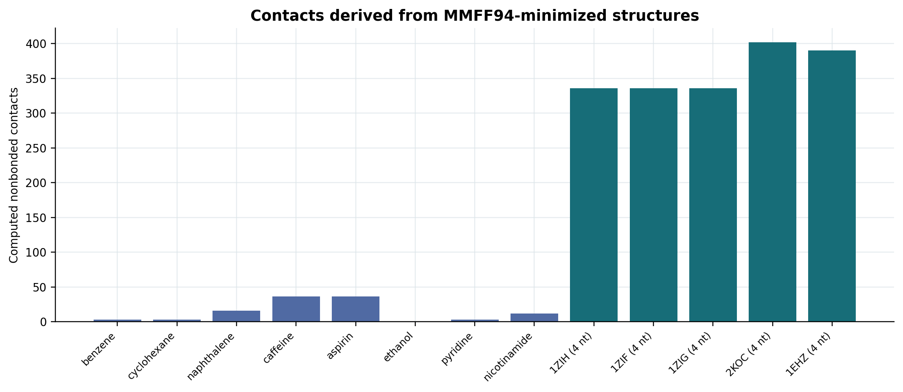
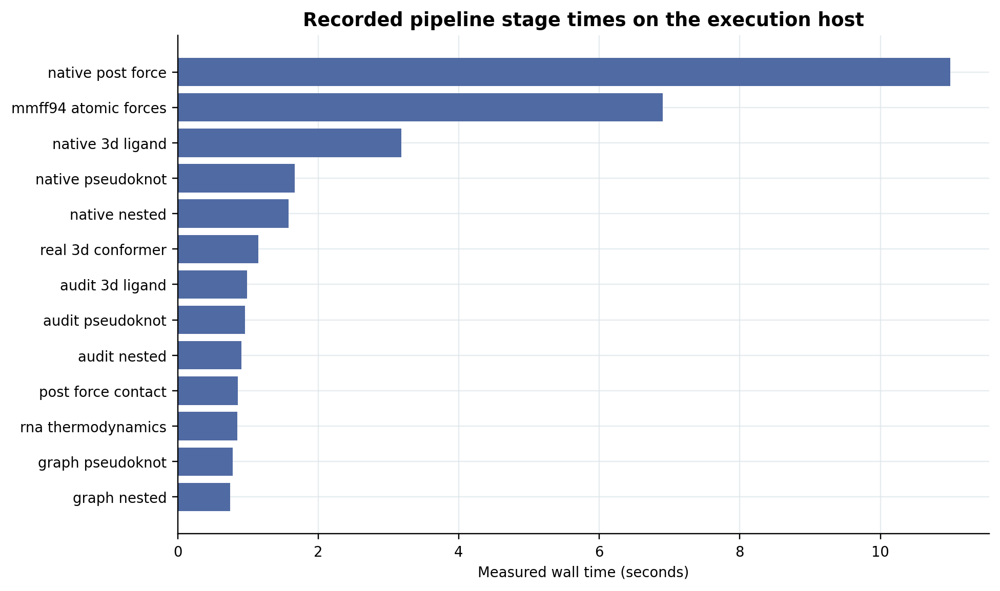

Structural Sensitivity in a Native Spiking Neural Network Under Molecular Graph Interventions

Computational neuroscience Molecular graphs Native spiking network Research evidence

An experimental study of how controlled changes to molecularly derived graph connections affect the activity of a compiled spiking neural network. The archive brings together the native implementation, original experiment records, independent numerical checks, negative controls, scientific manuscript, figures, and source provenance.

Research snapshot: 23 October 2026 · Study type: computational, intervention based · Repository: N-Molecular-Research

Read the manuscript · See the results · Inspect the tests · Explore the files · Reproduce the audit

────────

Research in brief

The research asks whether changing a computational graph’s connectivity changes the firing of a native spiking neural network when the experiment controls the stimulation seed, reset state, and neural operating conditions. It tests two distinct outcomes:

1. Graph intervention classification: whether neural activity distinguishes an original constructed graph from a rewired one on held-out stimulation seeds.
2. Paired neural response: how many target-neuron firing positions differ when molecular bonds, predicted RNA contacts, or generated spatial contacts are removed from a matched input graph.

These are measurements of computational structural sensitivity, not interchangeable measures of molecular-folding accuracy.

|Research record                                |Result                                    |What was measured                                                            |
|:----------------------------------------------|-----------------------------------------:|:----------------------------------------------------------------------------|
|Paired neural comparisons                      |**13,312**                                |Intact versus intervened graph conditions across three experimental campaigns|
|Independently reconstructed condition summaries|**208**                                   |Aggregated neural disagreement under defined controls                        |
|Archived graph-classifier statistic rows       |**100**                                   |Historical graph classification and control results                          |
|Native network scaffold                        |**118 neurons · 324 synapses**            |Compiled baseline before experiment-specific inputs and contacts             |
|Paired execution readout                       |**48 ticks · 22 target slots**            |Binary temporal spike-mask comparisons                                       |
|Final campaign                                 |**7,936 pairs · 15,872 native executions**|Two independently reset network executions per matched comparison            |
|Molecular mechanics                            |**13 / 13 converged**                     |MMFF94 optimizations of eight small molecules and five short RNA fragments   |
|Recorded project regression tests              |**81 passing named tests**                |Preserved historical software test log                                       |

Main result: within the tested representations and controls, the compiled network exhibited measurable and reproducible changes in firing activity after selected graph interventions. A cycle-preserving control and four additional RNA-labelled null results substantially narrow that interpretation. The manuscript provides the complete qualifications.

Experimental system

The original computational scaffold contains 118 neurons and 324 directed synapses. Experiment-specific input nodes and graph contacts are added to the native model; the compiled network’s state-transition routine is retained. Each paired test resets the network, applies matched deterministic stimulation, and varies the graph representation or selected connections.

flowchart LR
    A["Constructed DNA / RNA contact graphs"] --> E["Matched original and intervened graphs"]
    B["Chemical bond graphs from SMILES"] --> E
    C["Computed RNA pairing and candidate crossing contacts"] --> E
    D["ETKDG / MMFF94 derived spatial contacts"] --> E
    E --> F["Independently reset native SNN"]
    F --> G["48 tick firing records"]
    G --> H["Held out graph label classification"]
    G --> I["Paired 22 slot spike mask comparison"]
    H --> J["Statistics, controls and recorded evidence"]
    I --> J
    classDef input fill:#eef4f7,stroke:#688b9d,color:#17384a
    classDef neural fill:#e5f3ef,stroke:#24796c,color:#14463e
    classDef result fill:#f5f1e9,stroke:#9e8563,color:#55452b
    class A,B,C,D input
    class E,F,G neural
    class H,I,J result

Design schematic, not a measured molecular structure. Different branches were introduced in different experiments; it is not one simultaneous biological model.

Controlled factors

|Factor       |Conditions                                                                |
|:------------|:-------------------------------------------------------------------------|
|Graph        |Original contact representation versus a defined rewire or contact removal|
|Stimulation  |Same deterministic seed and matched declared stimulation policy           |
|Feedback     |Output-conditioned feedback versus a fixed-current stimulation schedule   |
|Plasticity   |Spike-timing-dependent plasticity (STDP) enabled versus weights frozen    |
|Run duration |48 network ticks per reset execution                                      |
|Neural output|Selected target-neuron spike masks, retained for auditing                 |

Neural response metric

For every matched pair, the network produces 48 consecutive binary spike masks for 22 selected target-neuron positions. The audit counts the positions that differ between the original and intervened graph:

Neural disagreement (%) =
    100 × sum over 48 ticks of popcount(original_mask XOR modified_mask)
    ÷ (48 × 22)

XOR identifies the bits that changed, and popcount counts those changed bits. The expression is displayed as plain text for reliable GitHub rendering; the exact mathematical definition and denominators are documented in the manuscript.

For grouped conditions, changed positions and denominators are summed across the matched pairs. A value of 20% means that 20% of the computational firing positions differ. It is not 20% biological prediction accuracy. The initial graph-classification experiments use a separate accuracy measure: correctly classified held-out graph labels divided by all evaluated labels.

Experimental results

1. Constructed graph topology and held-out classification

The first experiments used graph cases labelled with deposited DNA and RNA structure identifiers. The alternative contact graphs were computationally constructed, not taken as full experimentally determined atomic contact maps.

|PDB-associated case|Held-out classifications correct|Accuracy  |Holm-adjusted p|
|:------------------|-------------------------------:|---------:|--------------:|
|1BNA               |127 / 256                       |49.61%    |1.0000         |
|1ANA               |148 / 256                       |57.81%    |0.3173         |
|1WOE               |150 / 256                       |58.59%    |0.0952         |
|1RNA               |134 / 256                       |52.34%    |0.8692         |
|1ZIH               |119 / 256                       |46.48%    |1.0000         |
|**1KF1**           |**196 / 256**                   |**76.56%**|**0.0278**     |

The 1KF1-labelled constructed graph yielded 196/256 (76.56%) correct when its four-site directed cycles were broken, with a Holm-adjusted p value of 0.02783. A different intervention that preserved those four-site cycles, while changing their orientation, gave 116/256 (45.31%). The contrast is consistent with sensitivity to the tested cycle organization rather than generalized molecular geometry recognition. The cycle-preserving comparison was a subsequent control, not an independent prospective physical validation.

Four additional RNA-labelled constructed graph cases produced 44.92% (1ZIF), 44.92% (1ZIG), 53.52% (2KOC), and 48.05% (1EHZ) classification accuracy. None survived the documented four-comparison correction. These null findings are part of the published record.

|Held-out classification                                                                                                                                                      |Cycle-control comparison                                                                                                                                                |
|:---------------------------------------------------------------------------------------------------------------------------------------------------------------------------:|:----------------------------------------------------------------------------------------------------------------------------------------------------------------------:|
|||
|**Figure 1.** Original and fresh-seed graph classification                                                                                                                   |**Figure 2.** Cycle-breaking versus cycle-preserving controls                                                                                                           |

Source-defined directed-cycle interventions

Figure 3. Source-described changes to directed four-site cycles. These are constructed graph interventions, not experimentally reconstructed DNA geometry.

2. Chemical bond and spatial-contact interventions

Eight RDKit-validated SMILES molecules were tested: aspirin, benzene, caffeine, cyclohexane, ethanol, naphthalene, nicotinamide, and pyridine. Chemical bond interventions retain the declared atom set and change selected bond-derived graph edges. Later experiments use ETKDG conformers and MMFF94-optimized geometries to derive spatial contacts.

For example, removing caffeine’s bond-derived contacts changed 17.17% of neural firing positions with native feedback and plasticity enabled, versus 10.93% with plasticity frozen. These are separate controlled neural responses, not caffeine binding, activity, or toxicity measurements. Other experimental arms include zero and reversed plasticity effects; the complete factorial results are retained in the tables.

|Bond-graph intervention responses                                                                                                                                        |Paired-seed distribution for caffeine                                                                                                                                                   |
|:-----------------------------------------------------------------------------------------------------------------------------------------------------------------------:|:--------------------------------------------------------------------------------------------------------------------------------------------------------------------------------------:|
|||
|**Figure 5.** Responses across feedback and plasticity settings                                                                                                          |**Figure 6.** Distributions across matched stimulation seeds                                                                                                                            |

Both figures report neural firing-mask differences under computational contact interventions, not measurements of chemical action.

3. RNA pairing, candidate crossing structures, and neural response

The RNA experiments use five sequence-associated inputs: 1ZIH, 1ZIF, 1ZIG, 2KOC, and 1EHZ. Their recorded computational paths include a weighted noncrossing Nussinov-style solver, later selected RNA nearest-neighbor energy terms, and a separate heuristic search for candidate crossing stems.

|RNA identifier|Weighted solver pairs|Selected-energy-model pairs|Model energy (kcal/mol)|Crossing candidate selected|
|:-------------|--------------------:|--------------------------:|----------------------:|:-------------------------:|
|1ZIH          |4                    |4                          |−2.740                 |No                         |
|1ZIF          |4                    |4                          |−2.740                 |No                         |
|1ZIG          |4                    |4                          |−2.740                 |No                         |
|2KOC          |5                    |5                          |−5.430                 |No                         |
|1EHZ          |26                   |23                         |−14.604                |Yes                        |

These are model outputs. The selected energy terms and loop penalties do not constitute a complete calibrated RNA thermodynamic package. A heuristic crossing-stem candidate is not an experimentally validated pseudoknot. The atomistic RNA branch operates on four-nucleotide fragments rather than whole RNA molecules.

|Calculated RNA pairing                                                                                                                                        |Contact intervention response                                                                                                                                       |
|:------------------------------------------------------------------------------------------------------------------------------------------------------------:|:------------------------------------------------------------------------------------------------------------------------------------------------------------------:|
|||
|**Figure 7.** Pair counts from the documented computational solvers                                                                                           |**Figure 9.** Neural response after removal of calculated RNA contacts                                                                                              |

Partial-model RNA energy outputs

Figure 8. Energies calculated from the implemented subset of RNA thermodynamic terms. These are not experimental folding free energies.

4. Molecular mechanics and post-optimization contacts

RDKit MMFF94 calculations were recorded for eight small molecules and five four-nucleotide RNA fragments. All 13 recorded minimizations converged. Sampled analytical derivatives were compared with centered finite differences, with a maximum absolute discrepancy of approximately 1.59 × 10⁻⁷ kcal/mol/Å across the checked components. The extended campaign also produced 1,909 inferred nonbonded spatial contacts for derived graph interventions.

|Force-gradient numerical check                                                                                                                                             |Derived contact counts                                                                                                                                                               |
|:-------------------------------------------------------------------------------------------------------------------------------------------------------------------------:|:-----------------------------------------------------------------------------------------------------------------------------------------------------------------------------------:|
|||
|**Figure 10.** Sampled gradient consistency                                                                                                                                |**Figure 11.** Contacts produced from optimized geometry                                                                                                                             |

The numerical check establishes consistency between sampled derivative calculations. The derived contacts depend on the computational representation and spatial threshold; neither result validates experimental molecular structure.

5. Recorded computational workload

The archived computational comparisons comprise three different intervention campaigns. Their values indicate execution volume, not a progressive molecular prediction accuracy score.

|Intervention campaign                          |Matched pairs|Native reset executions|
|:----------------------------------------------|------------:|----------------------:|
|Chemical bond graphs                           |2,048        |4,096                  |
|Computed RNA contacts and ligand spatial graphs|3,328        |6,656                  |
|Extended RNA and post-force contact graphs     |7,936        |15,872                 |
|**Total across these campaigns**               |**13,312**   |**26,624**             |

The extended campaign used 64 deterministic excitation seeds and 48 ticks per network execution. Its recorded 7,936 matched pairs separate into 1,280 nested-RNA, 1,280 candidate-crossing-RNA, 2,048 ligand, and 3,328 post-force graph comparisons. These are computational trials; they are not biological replicates or independent patient samples.

Verification and tests

The archive separates recorded software execution, independent calculation from saved output, and release-file integrity. These are different levels of evidence.

|Evidence level           |What a reader can check                                                                              |
|:------------------------|:----------------------------------------------------------------------------------------------------|
|Native execution receipts|Compiler outputs, regression logs, sanitized samples and deterministic replay records                |
|Numerical recomputation  |Spike-mask disagreement totals, grouped conditions, original classifications and figure source tables|
|Archive integrity        |Hash manifests, ZIP CRC checks, source provenance and the Git LFS content-addressed archives         |

No single check substitutes for the other two, and none is a benchmark against experimental molecular ground truth.

|Check                                |Archived result                                                                                                       |Verification scope                                                                |
|:------------------------------------|:---------------------------------------------------------------------------------------------------------------------|:---------------------------------------------------------------------------------|
|Held-out graph intervention tests    |Six initial cases, 128 fresh stimulus-seed pairs and 256 labelled readouts per case                                   |Conditional graph-label discrimination                                            |
|Permutation and multiplicity controls|4,096 sign-swap permutations; Holm adjustment                                                                         |Computational null tests and corrected comparisons                                |
|Additional RNA negative tests        |Four new cases failed multiplicity correction                                                                         |Negative findings preserved                                                       |
|Spike-mask arithmetic                |**13,312 / 13,312** paired disagreements reconstructed                                                                |XOR/popcount counts from recorded 48-tick masks; **zero arithmetic discrepancies**|
|Condition-level recomputation        |**208** condition summaries                                                                                           |Reconstructed grouped outcomes                                                    |
|Classifier-statistic archive         |**100** historical statistic rows                                                                                     |Source-derived table audit                                                        |
|Historical project regression        |**81** passing named Python tests                                                                                     |Stored execution logs; not newly run by this README                               |
|Cross-compiler determinism           |**7,936** GCC/Clang paired comparison records byte-identical                                                          |Archived build and replay outputs                                                 |
|Sanitizer sample                     |**248** ASan/UBSan comparison records matched                                                                         |Independent sample, not a full 7,936-record sanitizer campaign                    |
|Earlier-record replay                |**3,328** pair records reproduced byte-for-byte                                                                       |Prior experiment against rebuilt native executable                                |
|Molecular mechanics                  |**13 / 13** converged minimizations                                                                                   |Sampled force-gradient numerical agreement, not experimental validation           |
|Full upstream suite                  |Complete earlier full-suite pass recorded; a later one-shot invocation was interrupted and followed by separate checks|Do not equate command-level checks with an uninterrupted later full-suite result  |
|Release snapshot on MacBook          |**405 / 405** original file SHA-256 matches; **6 / 6** nested ZIP CRC checks                                          |Copy and package integrity, not a fresh scientific rerun                          |

The source release has 1,267 archived ZIP members, and the historical packaging status records CRC and manifest-digest checks. The source archive is distributed as an LFS-backed ZIP; the original historical Git development timeline was not recovered as a complete sequence of commits.

|Recorded execution-stage timing                                                                                                                                |Recorded regression coverage                                                                                                                            |
|:-------------------------------------------------------------------------------------------------------------------------------------------------------------:|:------------------------------------------------------------------------------------------------------------------------------------------------------:|
|||
|**Figure 13.** Wall-clock timings from the recorded execution host                                                                                             |**Figure 14.** Historical software regression evidence                                                                                                  |

Timing excludes full compilation and is not a cross-tool benchmark. Passing tests verify the reported software checks, not biological prediction quality.

For the exact data and source trail, consult the claim-to-evidence matrix, technical validation, original experimental logs, and integrity ledger.

Repository structure

The repository root is a publication wrapper; the research contents remain in their original preserved folder hierarchy.

N-Molecular-Research/
├── README.md                         Research overview and reader navigation
├── .gitattributes                    Git LFS rules for ZIP archives
├── EVIDENCE/
│   ├── SOURCE_SHA256_MANIFEST.csv    405 relative source-file hashes and sizes
│   ├── SOURCE_DIRECTORIES.txt        65 preserved directory paths
│   ├── LARGE_FILE_INVENTORY.json
│   ├── COPY_VERIFICATION.json
│   └── EMPTY_DIRECTORIES.txt
└── original_extracted/
    └── Molecular_Graph_Research_Publication_20261023/
        ├── START_HERE.md
        ├── FOLDER_GUIDE.md
        ├── index.html
        ├── 01_Research_Article/            Research_Article.pdf and LaTeX source
        ├── 02_Publication_Figures/         14 source-derived PNG figures
        ├── 03_Study_Guide/                Explanation and equations
        ├── 04_Data_And_Results/           Results CSVs, audit workbook, dictionary
        ├── 05_Technical_Supplement/       Scientific and software validation
        ├── 06_Experimental_Evidence/      Original logs and evidence archive
        ├── 07_Reproduce_And_Verify/       Recalculation and publication scripts
        ├── 08_Executable_Source_Archive/  Native source and binary ZIP (LFS)
        ├── 09_Legacy_Edition/             Preserved earlier portfolios and archives
        ├── 10_Provenance_And_Integrity/   Path mapping, recorded checksums
        └── 11_Editorial_Submission/       Unsubmitted draft documents

|To examine…                  |Open                                                                                                                                                                                                                                                                                    |
|:----------------------------|:---------------------------------------------------------------------------------------------------------------------------------------------------------------------------------------------------------------------------------------------------------------------------------------|
|Original study and scope     |[Scientific manuscript](original_extracted/Molecular_Graph_Research_Publication_20261023/01_Research_Article/Research_Article.pdf) · [LaTeX source](original_extracted/Molecular_Graph_Research_Publication_20261023/01_Research_Article/Research_Article.tex)                          |
|Research explanations        |[Study guide](original_extracted/Molecular_Graph_Research_Publication_20261023/03_Study_Guide/ABOUT_THE_STUDY.md) · [Methods and equations](original_extracted/Molecular_Graph_Research_Publication_20261023/03_Study_Guide/METHODS_AND_EQUATIONS.md)                                   |
|Raw-derived measurements     |[Paired comparison data](original_extracted/Molecular_Graph_Research_Publication_20261023/04_Data_And_Results/ALL_V9_V10_V11_PAIRED_COMPARISONS.csv) · [RNA structures](original_extracted/Molecular_Graph_Research_Publication_20261023/04_Data_And_Results/RNA_FOLDING_STRUCTURES.csv)|
|Figure provenance            |[Figure-to-source ledger](original_extracted/Molecular_Graph_Research_Publication_20261023/04_Data_And_Results/FIGURE_PROVENANCE.csv) · [All figures](original_extracted/Molecular_Graph_Research_Publication_20261023/02_Publication_Figures/)                                         |
|Source and execution evidence|[Native source archive](original_extracted/Molecular_Graph_Research_Publication_20261023/08_Executable_Source_Archive/) · [Preserved experiment logs](original_extracted/Molecular_Graph_Research_Publication_20261023/06_Experimental_Evidence/original_logs/)                         |
|Recalculation scripts        |[Verification directory](original_extracted/Molecular_Graph_Research_Publication_20261023/07_Reproduce_And_Verify/) · [Historical verification scripts](original_extracted/Molecular_Graph_Research_Publication_20261023/07_Reproduce_And_Verify/Original_Verification_Scripts/)        |
|Original file lineage        |[Provenance and integrity](original_extracted/Molecular_Graph_Research_Publication_20261023/10_Provenance_And_Integrity/) · [Legacy portfolio](original_extracted/Molecular_Graph_Research_Publication_20261023/09_Legacy_Edition/)                                                     |

Reproducibility

1. Clone with Git LFS

Six preserved ZIP file paths are tracked by Git LFS. Two of the historical ZIP paths contain identical bytes, so these six paths correspond to five distinct LFS content hashes. Both filenames are retained for provenance; they need not store duplicate binary payloads.

git clone https://github.com/fireside25a-beep/N-Molecular-Research.git
cd N-Molecular-Research
git lfs pull
git lfs ls-files

A GitHub-generated source download may not contain the large LFS payloads. Use a Git LFS-enabled clone for full archive access.

2. Verify the preserved 405 original files

This read-only script compares each original research path, file size, and SHA-256 hash against the repository manifest. It does not execute the neural model or change any research file.

python3 - <<'PY'
from pathlib import Path
from hashlib import sha256
import csv
import sys

root = Path('original_extracted')
manifest = Path('EVIDENCE/SOURCE_SHA256_MANIFEST.csv')

if not root.is_dir() or not manifest.is_file():
    sys.exit('FAIL: required archive directory or manifest is missing')
with manifest.open(encoding='utf-8', newline='') as stream:
    rows = list(csv.DictReader(stream))
if len(rows) != 405:
    sys.exit('FAIL: manifest must contain 405 original file records')
names = [row['relative_path'] for row in rows]
if len(set(names)) != len(names):
    sys.exit('FAIL: duplicate relative paths in manifest')
actual = {p.relative_to(root).as_posix() for p in root.rglob('*') if p.is_file()}
if actual != set(names):
    sys.exit('FAIL: research file paths differ from manifest')
for row in rows:
    p = root / row['relative_path']
    h = sha256()
    with p.open('rb') as stream:
        for block in iter(lambda: stream.read(1024 * 1024), b''):
            h.update(block)
    if p.stat().st_size != int(row['size_bytes']) or h.hexdigest() != row['sha256']:
        sys.exit('FAIL: file differs from source manifest: ' + row['relative_path'])
print('PASS: 405 original file paths, sizes and SHA-256 hashes match')
PY

3. Recalculate recorded outcomes or rerun native experiments

Recalculation from preserved spike masks and fresh native execution are distinct tasks. The publication’s verification scripts audit original counts and tables; the source archive retains the compiled research implementation and build/replay instructions.

For native reruns, extract the source ZIP to a new location, inspect its dependencies and script entry points, and direct fresh outputs away from the preserved evidence. No universal one-line native build instruction is asserted without checking the extracted source and target toolchain.

Interpretation and scope

Demonstrated in the archived computational evidence: selected constructed DNA/RNA graph contrasts can affect native neural firing and, in some conditions, yield held-out intervention discrimination; selected chemical-bond, RNA-pairing, and geometry-derived contact removals change matched spike masks; the recorded numerical observations can be independently recomputed; compiler and regression receipts are preserved.

Not demonstrated by these experiments: blinded experimental base-pair precision/recall, full-RNA three-dimensional structure accuracy, molecular-binding affinity, chemical efficacy, or superiority to RNAfold, RNAstructure, BPfold, other graph-learning methods, or molecular dynamics. Some observed graph effects could be captured by simpler graph algorithms; that requires direct, same-task baselines.

The original study is an archival computational manuscript, not evidence of journal peer review. The repository snapshot does not recreate missing original development Git history. Third-party rights and licenses need review before adding a blanket repository license or promising unrestricted reuse.

Source and citation

The authoritative reference for numerical and scientific claims is the research manuscript, supported by raw-derived results, experiment receipts, and source provenance. Until a formal DOI or citation record exists, reference the repository URL, manuscript title and research snapshot date. No DOI, independent biological validation, or peer-review status is implied.
