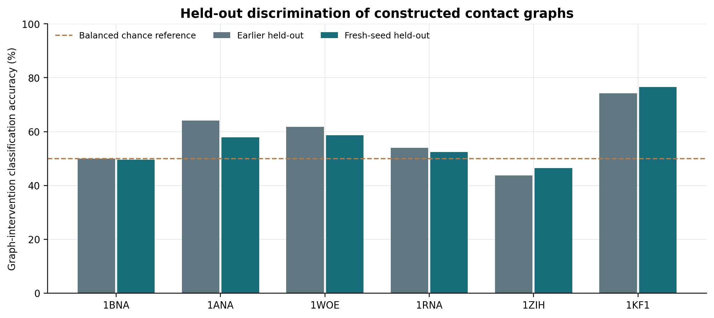
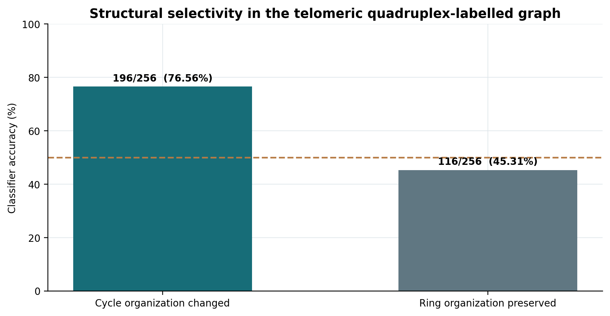
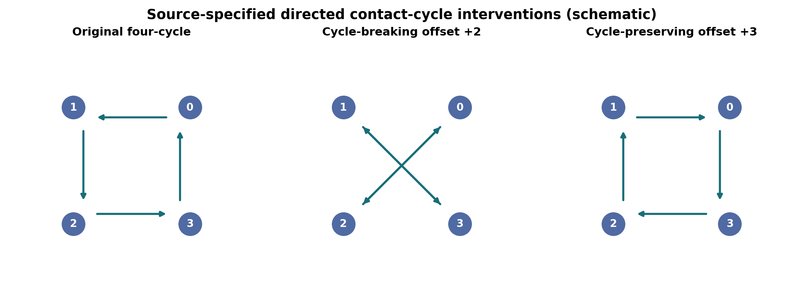
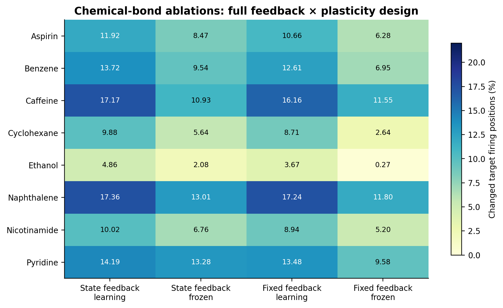
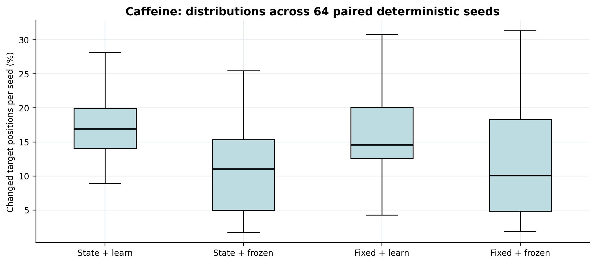
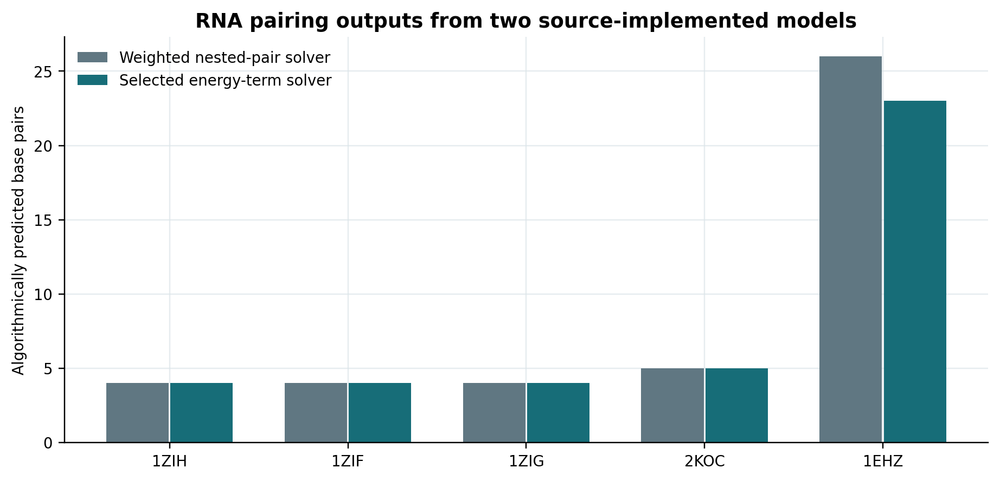
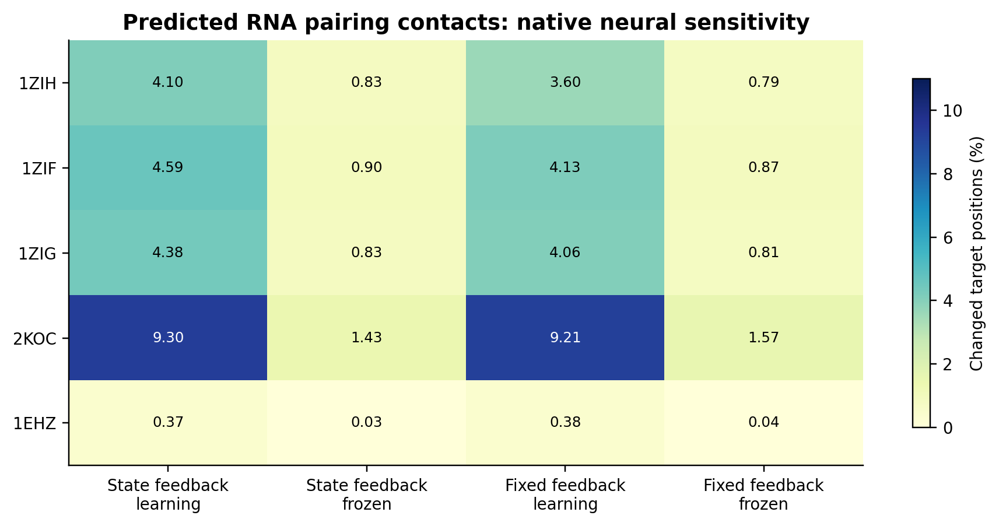
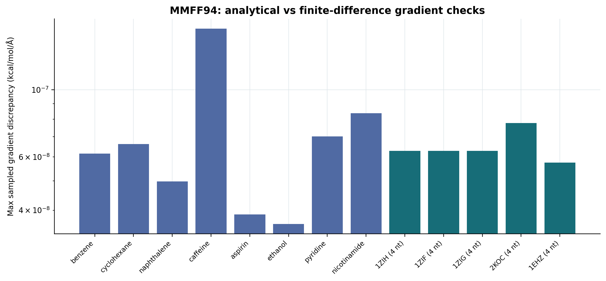
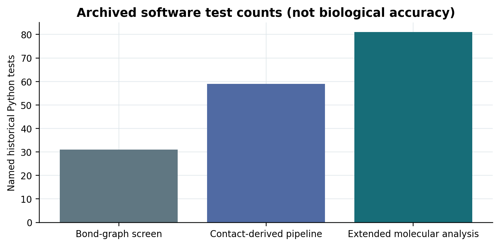

# Structural Sensitivity in a Native Spiking Neural Network Under Molecular Graph Interventions

   

**Controlled graph interventions, native spiking dynamics, molecular representations, and independently auditable computational results\.**

This repository archives a research study asking whether changes to molecularly derived *computational graph connectivity* can be distinguished through the firing activity of a compiled spiking neural network\. The study combines constructed DNA and RNA contact graphs, chemical bond interventions, computational RNA pairing, molecular conformers, and force\-derived spatial contacts\. It documents both responses and negative controls, with the original records retained for inspection\.

**Research snapshot:** 23 October 2026 · **Type:** archival computational research · **Status:** manuscript and evidence release; not presented as peer reviewed

[**Read the research paper**](original_extracted/Molecular_Graph_Research_Publication_20261023/01_Research_Article/Research_Article.pdf) · [**Results and figures**](#findings) · [**Tests and verification**](#verification-and-tests) · [**Repository guide**](#repository-contents) · [**How to reproduce**](#reproducibility)

---

## Research question and contribution

The study evaluates three testable propositions:

1. Some constructed graph interventions can be classified from held\-out native SNN activity\.
2. Breaking directed graph cycles and changing connections while preserving those cycles need not give the same result\.
3. Removing defined chemical bonds, calculated RNA\-pairing contacts, or geometry\-derived spatial contacts can change matched neural firing masks\.

The key result is **reproducible sensitivity to selected graph interventions**\. This is not a claim that the SNN predicts the experimentally correct fold or binding behavior of a molecule\.

### Evidence at a glance

|Recorded measurement                                            |Result      |
|:---------------------------------------------------------------|-----------:|
|Paired neural comparisons audited from saved spike masks        |**13,312**  |
|Native SNN executions across those paired comparisons           |**26,624**  |
|Independently recomputed condition summaries                    |**208**     |
|Archived graph-classifier statistic rows                        |**100**     |
|Historical named Python tests reported passing                  |**81**      |
|GCC/Clang byte-identical comparison records in extended campaign|**7,936**   |
|Independently matching sampled sanitizer comparison records     |**248**     |
|Converged MMFF94 optimizations                                  |**13 of 13**|

These figures are counts of **computations and recorded software evidence**, not counts of experimentally validated molecules, biological samples, or prediction successes\.

## Experimental method

The native baseline contains **118 neurons and 324 directed synapses**\. The experiment adds input nodes and graph\-derived contacts without replacing the compiled network state\-transition routine\. A matched pair consists of independently reset runs under the same deterministic seed and declared stimulation policy, differing in a specified graph connection or contact intervention\.

### Research workflow

|Stage               |What the experiment does                                                                                                                                  |
|:-------------------|:---------------------------------------------------------------------------------------------------------------------------------------------------------|
|**1. Represent**    |Construct a directed contact graph, parse a chemical SMILES graph, calculate RNA base-pair contacts, or derive spatial contacts from optimized geometries.|
|**2. Intervene**    |Compare a declared intact graph against a cycle rewire, bond removal, RNA-contact removal, or spatial-contact removal.                                    |
|**3. Run natively** |Reset the compiled spiking network and execute matched 48-tick trials under controlled stimulation.                                                       |
|**4. Vary controls**|Compare native-output feedback against fixed stimulation, with STDP enabled or weights frozen.                                                            |
|**5. Measure**      |Classify graph intervention labels, or compare 48 consecutive firing masks for 22 target-neuron positions.                                                |
|**6. Audit**        |Recalculate spike-mask differences, summary statistics, compiler parity, numerical gradients, and archive integrity.                                      |

This is a description of the recorded computational workflow\. The separate research branches were introduced over time and do not form a single simultaneous biological folding simulator\.

**Paired neural disagreement** is the count of firing positions that change between the intact and modified graph, divided by the **48 ticks × 22 target positions**, expressed as a percentage\. For grouped conditions, the counts and denominators are aggregated across matched pairs\. **Held\-out classification accuracy is a different measure** and is never pooled with disagreement percentages\.

## Findings

### 1\. Constructed contact graphs and directed\-cycle controls

In the 1KF1\-labelled computational graph, a cycle\-breaking rewire produced **196 correct classifications out of 256 held\-out labels &#40;76\.56%&#41;**, with a six\-case Holm\-adjusted **p = 0\.02783**\. A separate intervention that changed connections while **preserving four\-site directed cycles** produced **116/256 &#40;45\.31%&#41;**\.

The difference is consistent with sensitivity to the tested cycle organization\. The rewirings were *constructed computational controls*, not two experimentally observed DNA conformations\. Four additional RNA\-labelled constructed\-graph cases did not pass their documented multiple\-test correction\.

|Case    |Held-out accuracy|Holm-adjusted p|
|:-------|----------------:|--------------:|
|1BNA    |49.61%           |1.0000         |
|1ANA    |57.81%           |0.3173         |
|1WOE    |58.59%           |0.0952         |
|1RNA    |52.34%           |0.8692         |
|1ZIH    |46.48%           |1.0000         |
|**1KF1**|**76.56%**       |**0.0278**     |

*Figure 1\. Constructed graph\-label discrimination using held\-out stimulation seeds\.*

*Figure 2\. The cycle\-preserving comparison is an essential negative control\.*

*Figure 3\. Directed\-cycle topology drawn from the original documented graph interventions\. This replaces a generic schematic with an actual archived research figure\.*

### 2\. Chemical bond intervention and controlled neural response

Eight RDKit\-validated small molecules were represented by their chemical graphs: **aspirin, benzene, caffeine, cyclohexane, ethanol, naphthalene, nicotinamide, and pyridine**\. The initial intervention retains the same atoms and removes defined bond\-derived computational connections\. Later studies examine optimized conformers and proximity\-derived contacts\.

For caffeine’s bond\-graph intervention, the recorded native feedback condition produced **17\.17% changed target firing positions** with plasticity enabled and **10\.93%** with plasticity frozen\. These are neural disagreement measurements, not molecular potency or ligand activity\. Other inputs and controls include zero response and learning effects in different directions\.

*Figure 5\. Chemical graph sensitivity across feedback and plasticity conditions\.*

*Figure 6\. Seed\-level response distributions instead of a single averaged score\.*

### 3\. RNA pairing and contact interventions

Five RNA sequence\-associated inputs, **1ZIH, 1ZIF, 1ZIG, 2KOC, and 1EHZ**, were used to evaluate computational pairing and neural sensitivity to the resulting contacts\. The recorded methods include a weighted noncrossing pairing solver, selected nearest\-neighbor energy terms, and a heuristic crossing\-stem candidate search\.

|RNA-associated input|Weighted solver pairs|Selected-energy-model pairs|
|:-------------------|--------------------:|--------------------------:|
|1ZIH                |4                    |4                          |
|1ZIF                |4                    |4                          |
|1ZIG                |4                    |4                          |
|2KOC                |5                    |5                          |
|1EHZ                |26                   |23                         |

The selected\-energy model generated an internal energy of approximately **−14\.604 kcal/mol** for 1EHZ and a crossing\-stem *candidate*\. Those outputs have not been validated as experimentally accurate structures, and the implemented energy terms are not a complete calibrated RNAfold model\.

*Figure 7\. Recorded pair counts from distinct computational pairing methods\.*

*Figure 9\. Neural activity differences after removing calculated RNA contacts\. These are not RNA base\-pair accuracy scores\.*

### 4\. Molecular mechanics and post\-optimization contacts

The extended experiment uses **RDKit ETKDG** to generate conformations and **MMFF94** for energy and force evaluation\. The 13 recorded minimizations include **eight small molecules and five four\-nucleotide RNA fragments**, rather than entire RNA molecules\. All 13 minimizations converged\.

Sampled analytical gradients agreed with centered finite\-difference checks to a maximum recorded discrepancy of approximately **1\.59 × 10⁻⁷ kcal/mol/Å** across checked components\. The subsequent graph construction derived **1,909 nonbonded spatial contacts** for network interventions\. This establishes numerical consistency and recorded computational contact sensitivity, not validation against experimental molecular forces\.

*Figure 10\. Numerical force consistency on sampled Cartesian components\.*

### 5\. Experimental workload and denominators

|Computational intervention family  |Paired comparisons|Independently reset native executions|
|:----------------------------------|-----------------:|------------------------------------:|
|Chemical bond graphs               |2,048             |4,096                                |
|Computed RNA and ligand contacts   |3,328             |6,656                                |
|Extended RNA and atomistic contacts|7,936             |15,872                               |
|**Total**                          |**13,312**        |**26,624**                           |

The extended campaign used **64 deterministic excitation seeds** per condition and **48 neural ticks** per execution\. Its 7,936 comparisons comprise 1,280 nested\-RNA, 1,280 crossing\-candidate RNA, 2,048 ligand spatial\-graph, and 3,328 post\-force contact comparisons\. These are repeated computational trials, not independent biological specimens\.

## Verification and tests

The release preserves raw evidence and multiple independent checks\. It distinguishes historical execution logs, recalculation of stored results, and byte\-level preservation verification\.

|Validation               |Evidence recorded                                                                                                                         |
|:------------------------|:-----------------------------------------------------------------------------------------------------------------------------------------|
|**Native neural results**|13,312 individual pairwise firing differences independently recalculated from saved 48-tick masks, with **zero arithmetic discrepancies**.|
|**Condition summaries**  |208 factorial condition summaries reconstructed from the archived records.                                                                |
|**Graph statistics**     |100 archived classifier-statistic rows; 4,096 sign-swap permutations used for the original hypothesis tests, with Holm correction.        |
|**Regression tests**     |81 passing named Python project tests in preserved historical logs.                                                                       |
|**Cross-compiler replay**|7,936 paired records reproduced byte-for-byte between GCC and Clang native builds.                                                        |
|**Sanitizers**           |248 independently sampled records matched under AddressSanitizer and UndefinedBehaviorSanitizer checks. This is sampled coverage.         |
|**Historical replay**    |3,328 earlier paired records reproduced identically with a rebuilt native executable.                                                     |
|**Molecular mechanics**  |13/13 converged MMFF94 optimizations and sampled numerical force-gradient checks.                                                         |
|**Source preservation**  |405 original files hash-verified in a separate publication copy; six nested ZIP CRC checks passed.                                        |

One complete earlier upstream test\-suite pass is historically recorded\. A later one\-shot upstream suite invocation was interrupted; separate subsequent checks are preserved but are not represented as an uninterrupted complete suite pass\. The software tests verify the implementation and recordings, not experimental biological predictive accuracy\.

*Figure 14\. Preserved regression evidence by experimental release\.*

Consult the [claim/evidence matrix](original_extracted/Molecular_Graph_Research_Publication_20261023/04_Data_And_Results/CLAIM_EVIDENCE_MATRIX.csv), [test case index](original_extracted/Molecular_Graph_Research_Publication_20261023/04_Data_And_Results/TEST_CASE_INDEX.csv), [technical validation](original_extracted/Molecular_Graph_Research_Publication_20261023/05_Technical_Supplement/TECHNICAL_VALIDATION.md), and [original execution logs](original_extracted/Molecular_Graph_Research_Publication_20261023/06_Experimental_Evidence/original_logs/)\.

## Repository contents

The repository preserves the dated research publication tree, rather than reorganizing or modifying the scientific source files\.

|Path                             |Contents                                                                                                |
|:--------------------------------|:-------------------------------------------------------------------------------------------------------|
|**README.md**                    |This research overview.                                                                                 |
|**EVIDENCE/**                    |Original file SHA-256 manifest, copy-verification record, directory inventory, and large-file inventory.|
|**original_extracted/**          |Preserved extracted research snapshot.                                                                  |
|**01_Research_Article/**         |16-page manuscript, LaTeX and explanatory notes.                                                        |
|**02_Publication_Figures/**      |14 PNGs derived from source data.                                                                       |
|**03_Study_Guide/**              |Study explanation, methods and equations.                                                               |
|**04_Data_And_Results/**         |CSVs, audit workbook, experimental metrics and figure provenance.                                       |
|**05_Technical_Supplement/**     |Source and validation boundaries.                                                                       |
|**06_Experimental_Evidence/**    |Original experiment logs and complete evidence ZIP.                                                     |
|**07_Reproduce_And_Verify/**     |Original and publication verification scripts.                                                          |
|**08_Executable_Source_Archive/**|Original executable source and binary release ZIP.                                                      |
|**09_Legacy_Edition/**           |Earlier portfolios and original historical archives.                                                    |
|**10_Provenance_And_Integrity/** |Source path mapping, hashes and integrity reports.                                                      |
|**11_Editorial_Submission/**     |Unsubmitted editorial and availability drafts.                                                          |

The numbered folders are all located within **original\_extracted/Molecular\_Graph\_Research\_Publication\_20261023/**\.

**Start reading:** [Scientific paper](original_extracted/Molecular_Graph_Research_Publication_20261023/01_Research_Article/Research_Article.pdf) · [Study guide](original_extracted/Molecular_Graph_Research_Publication_20261023/03_Study_Guide/ABOUT_THE_STUDY.md) · [Data dictionary](original_extracted/Molecular_Graph_Research_Publication_20261023/04_Data_And_Results/DATA_DICTIONARY.md) · [Full folder guide](original_extracted/Molecular_Graph_Research_Publication_20261023/FOLDER_GUIDE.md) · [Publication index](original_extracted/Molecular_Graph_Research_Publication_20261023/index.html)

## Reproducibility

**Complete archive access requires Git LFS\.** Clone **https://github\.com/fireside25a\-beep/N\-Molecular\-Research\.git** with Git and Git LFS installed, then retrieve the LFS objects\. All six nested ZIP paths are retained; two historical ZIPs are byte\-identical and correspond to the same content\-addressed LFS object\.

**Verify byte preservation:** compare every file in **original\_extracted/** with its path, size, and SHA\-256 in [EVIDENCE/SOURCE\_SHA256\_MANIFEST\.csv](EVIDENCE/SOURCE_SHA256_MANIFEST.csv)\. The archived snapshot records 405 original files and 65 original directories\. Git does not natively represent empty directories; the release records their paths in [EVIDENCE/SOURCE\_DIRECTORIES\.txt](EVIDENCE/SOURCE_DIRECTORIES.txt)\.

**Recalculate recorded results:** start with [07\_Reproduce\_And\_Verify](original_extracted/Molecular_Graph_Research_Publication_20261023/07_Reproduce_And_Verify/) and the [original verification scripts](original_extracted/Molecular_Graph_Research_Publication_20261023/07_Reproduce_And_Verify/Original_Verification_Scripts/)\. Independent numerical auditing of stored output is not the same operation as rerunning the native model\.

**Rerun native computation:** examine the build and replay instructions inside the [executable source archive](original_extracted/Molecular_Graph_Research_Publication_20261023/08_Executable_Source_Archive/)\. Extract to a new location and write new outputs separately from the preserved evidence\. The archive includes historical source and binaries, but no unverified universal build command is prescribed here\.

## Interpretation and research boundaries

The study demonstrates reproducible computational sensitivity of a compiled spiking neural network to **selected** constructed graph rewirings and derived molecular contacts\. It does not demonstrate blind experimental RNA base\-pair F1, full RNA 3D structural accuracy, DNA folding prediction, ligand affinity, medicinal efficacy, or superiority to established folding and graph\-analysis algorithms\. Some responses may reflect simple graph invariants, which require direct same\-task algorithmic baselines\.

The repository is an **archival research release**, not a claim of peer review or a recovered complete original Git development history\. Historical logs and preserved sources are supplied to make the record inspectable\. The original manuscript and its supporting data take precedence over this overview\. Third\-party redistribution and licensing rights should be checked before claiming blanket open\-source licensing\.

**Primary scientific record:** [Research\_Article\.pdf](original_extracted/Molecular_Graph_Research_Publication_20261023/01_Research_Article/Research_Article.pdf) · [Data and results](original_extracted/Molecular_Graph_Research_Publication_20261023/04_Data_And_Results/) · [Experimental evidence](original_extracted/Molecular_Graph_Research_Publication_20261023/06_Experimental_Evidence/) · [Integrity records](original_extracted/Molecular_Graph_Research_Publication_20261023/10_Provenance_And_Integrity/)\.
